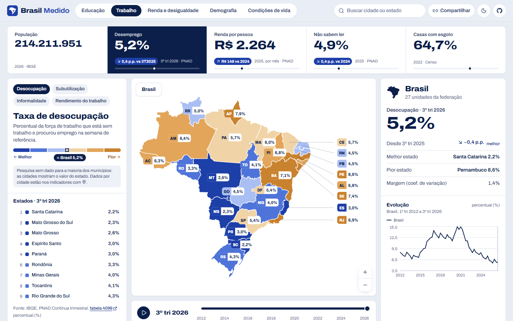
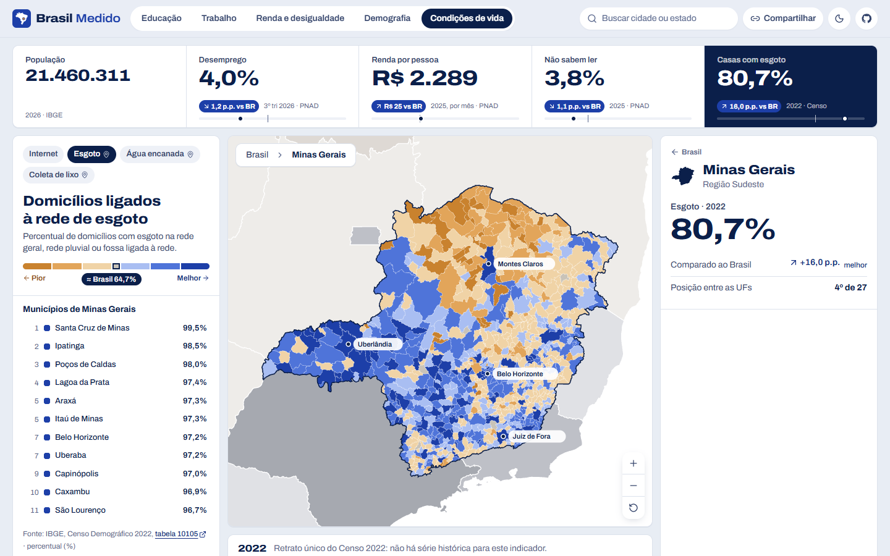
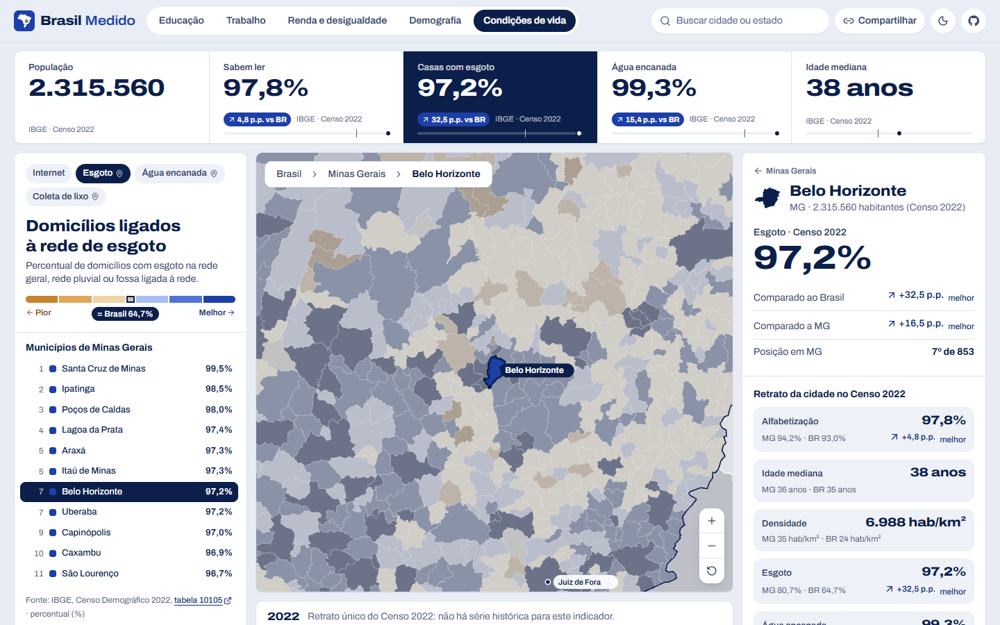
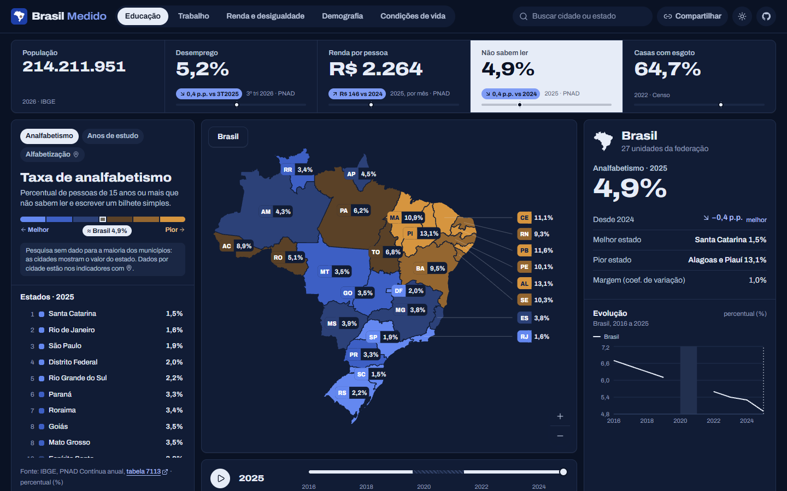
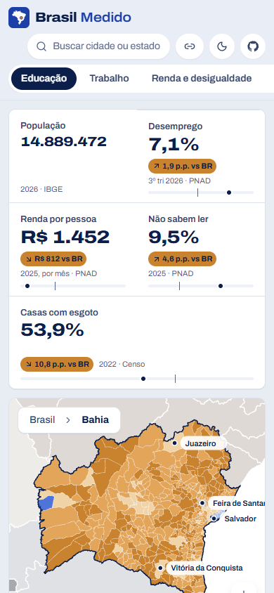
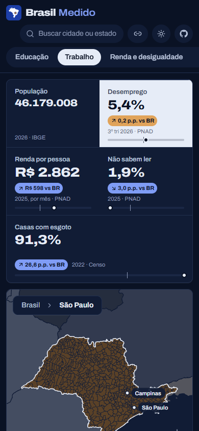

<h1 align="center">
  
  Brasil Medido
</h1>

<p align="center">
  Atlas de 16 indicadores oficiais do IBGE: todos por estado, e seis deles em cada um dos 5.570 municípios.
  <br />
  <a href="https://welberc1.github.io/BrasilMedido/"><strong>Abrir o site</strong></a>
  ·
  <a href="#de-onde-vêm-os-números">De onde vêm os números</a>
  ·
  <a href="#rodando-na-sua-máquina">Rodar localmente</a>
</p>

<p align="center">
  
</p>

Escolha um indicador e o mapa pinta cada estado em relação ao Brasil: azul-cobalto onde a situação é
melhor que o valor nacional, ocre onde é pior. No alto ficam cinco números do lugar que está na tela. Para
o país e os estados são população, desemprego, renda por pessoa, analfabetismo e esgoto; numa cidade, o
placar passa para os dados do Censo. Clicar em um desses números troca o indicador do mapa.

Ao clicar em um estado, o mapa se aproxima dele e mostra os municípios. Uma cidade clicada abre a
ficha dela com o retrato do Censo 2022, comparado com o estado e com o país. A busca no topo leva direto a
qualquer município, e o endereço da página guarda a visão atual: dá para mandar a alguém o link de "Belo
Horizonte, esgoto".

## Telas

<table>
  <tr>
    <td width="50%"></td>
    <td width="50%"></td>
  </tr>
  <tr>
    <td>Minas Gerais aberto: 853 municípios pelo esgoto ligado à rede.</td>
    <td>Belo Horizonte: 97,2% dos domicílios na rede, 7º lugar em Minas.</td>
  </tr>
</table>

<p align="center">
  
  <br />
  <sub>Modo noturno. No escuro as rampas de cor são outras: quanto mais longe do Brasil, mais claro e saturado o tom.</sub>
</p>

<p align="center">
  
  &nbsp;&nbsp;
  
</p>

## Indicadores

Dez indicadores têm série histórica e cobrem o Brasil e as 27 unidades da federação.

| Tema | Indicador | Pesquisa | Tabela SIDRA | Série |
|---|---|---|---|---|
| Educação | Taxa de analfabetismo (15 anos ou mais) | PNAD Contínua anual | [7113](https://sidra.ibge.gov.br/tabela/7113) | 2016–2025 |
| Educação | Média de anos de estudo (25 anos ou mais) | PNAD Contínua anual | [7126](https://sidra.ibge.gov.br/tabela/7126) | 2016–2025 |
| Trabalho | Taxa de desocupação | PNAD Contínua trimestral | [4099](https://sidra.ibge.gov.br/tabela/4099) | 2012–2026 |
| Trabalho | Taxa composta de subutilização | PNAD Contínua trimestral | [4099](https://sidra.ibge.gov.br/tabela/4099) | 2012–2026 |
| Trabalho | Taxa de informalidade | PNAD Contínua trimestral | [8529](https://sidra.ibge.gov.br/tabela/8529) | 2015–2026 |
| Trabalho | Rendimento médio habitual do trabalho | PNAD Contínua trimestral | [5436](https://sidra.ibge.gov.br/tabela/5436) | 2012–2026 |
| Renda | Rendimento domiciliar per capita | PNAD Contínua anual | [7533](https://sidra.ibge.gov.br/tabela/7533) | 2012–2025 |
| Renda | Índice de Gini | PNAD Contínua anual | [7435](https://sidra.ibge.gov.br/tabela/7435) | 2012–2025 |
| Demografia | População residente estimada | Estimativas de População | [6579](https://sidra.ibge.gov.br/tabela/6579) | 2001–2026 |
| Condições de vida | Domicílios com internet | PNAD Contínua anual | [7307](https://sidra.ibge.gov.br/tabela/7307) | 2016–2025 |

Os outros seis vêm do Censo Demográfico 2022 e chegam a cada município.

| Indicador | Tabela SIDRA | Como é obtido |
|---|---|---|
| Taxa de alfabetização (15 anos ou mais) | [10091](https://sidra.ibge.gov.br/tabela/10091) | publicado pelo IBGE |
| Idade mediana | [10097](https://sidra.ibge.gov.br/tabela/10097) | publicado pelo IBGE |
| Densidade demográfica | [4714](https://sidra.ibge.gov.br/tabela/4714) | publicado pelo IBGE |
| Domicílios ligados à rede de esgoto | [10105](https://sidra.ibge.gov.br/tabela/10105) | calculado a partir das contagens de domicílios |
| Domicílios com água da rede geral | [10103](https://sidra.ibge.gov.br/tabela/10103) | calculado a partir das contagens de domicílios |
| Domicílios com coleta de lixo | [10109](https://sidra.ibge.gov.br/tabela/10109) | calculado a partir das contagens de domicílios |

## De onde vêm os números

Tudo sai dos serviços abertos do IBGE: o SIDRA para as tabelas, Localidades para a lista de municípios e
Malhas para os contornos do mapa. O valor do Brasil é sempre o que o IBGE publica para o país; a média dos
estados não entra em conta nenhuma, porque daria a Roraima o mesmo peso de São Paulo.

A PNAD Contínua é feita por amostra e não tem dado para a maioria dos municípios, então nos indicadores
dela a cidade mostra o valor do estado, com um aviso na tela. Na ficha do lugar selecionado, cada
estimativa da PNAD vem com o coeficiente de variação, e o site marca as que passam de 15%. Esse corte é uma escolha de leitura
do projeto, não uma regra do IBGE.

Período sem divulgação fica listrado no gráfico. Em 2020 e 2021 o IBGE não publicou o módulo anual de
educação da PNAD, por exemplo, e nada foi preenchido no lugar.

Para conferir se o site mostra o que o IBGE publicou, o script [`scripts/verificar_dados.py`](scripts/verificar_dados.py)
consulta o SIDRA por outro caminho (a API clássica, `apisidra.ibge.gov.br`, e não a que o projeto usa
para baixar os dados) e compara valor por valor. Na última execução foram 1.272 comparações e nenhuma divergência: os 10
indicadores com série histórica em três períodos cada, para o Brasil e as 27 UFs, e os 6 do Censo para o
Brasil, as UFs e 44 municípios (40 sorteados e 4 capitais). Os
percentuais de esgoto, água e lixo foram recalculados do zero a partir das contagens brutas e bateram.

## Como funciona

O projeto não tem servidor. Um programa em .NET 10 baixa os dados do IBGE, confere se o Brasil e as 27
unidades da federação vieram em cada tabela e só grava os arquivos se todos os indicadores passarem; se o
IBGE estiver fora do ar, o site continua com a última versão boa. Períodos que o IBGE não publicou viram
lacuna, não erro. O site é estático, feito em React, e lê esses arquivos.

```
etl/   .NET 10 · baixa, valida e grava JSON         (testes em xUnit)
web/   React + TypeScript + Vite + Tailwind          (testes em Vitest)
       mapa em SVG com d3-geo, gráficos com Recharts
```

Na abertura, o site baixa só o mapa dos estados; a malha de municípios de cada estado vem quando o estado
é clicado.

Para acrescentar um indicador, inclua uma entrada em
[`etl/BrasilMedido.Etl/Catalog.cs`](etl/BrasilMedido.Etl/Catalog.cs) com a tabela, a variável e os filtros
do SIDRA, além de unidade, polaridade (se maior é melhor) e universo. A interface lê o catálogo e monta o resto.

## Rodando na sua máquina

Precisa de .NET 10, Node 22 e internet para falar com o IBGE.

```bash
dotnet test                                   # testes do pipeline de dados
dotnet run --project etl/BrasilMedido.Etl     # baixa e grava os dados (1 a 2 minutos)

cd web
npm install
npx vitest run                                # testes dos cálculos
npm run dev                                   # http://localhost:5173
```

## Publicação

O workflow [`.github/workflows/deploy.yml`](.github/workflows/deploy.yml) roda a cada push na `main`, no dia
5 de cada mês e sob demanda: testa, atualiza os dados, versiona o que mudou e publica no GitHub Pages. No repositório, o GitHub Pages precisa estar com a origem em
*Settings → Pages → Source: GitHub Actions*.

## Autor

Feito por [Welber Caetano](https://www.linkedin.com/in/welber-caetano/). O site é gratuito e aberto a
qualquer pessoa; os dados são públicos, do IBGE, e podem ser reutilizados citando a fonte. Projeto
independente, sem vínculo com o IBGE.

O código está sob a [licença MIT](LICENSE).
